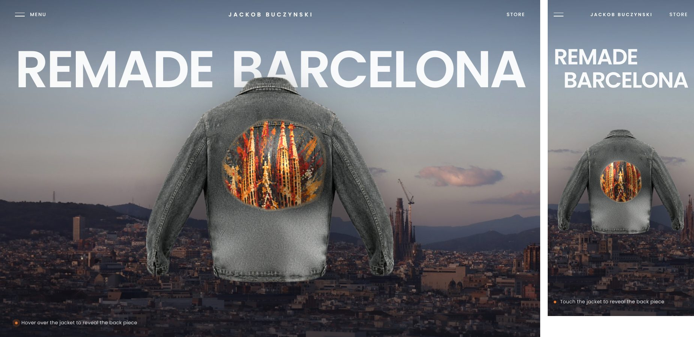

# Jackob Buczynski — hero

React + Vite hero for the Jackob Buczynski site: a grey denim jacket floats over the Barcelona skyline, and hovering it reveals the hand-painted Sagrada Família back piece with a WebGL bulge under the cursor.



## Run it

```bash
npm install
npm run dev        # http://localhost:5173
npm run build      # production build in dist/
```

## How the jacket works

- `src/components/JacketReveal.jsx` — three.js on a single canvas (no React Three Fiber needed).
  - A ping-pong render target stores the reveal: the cursor slowly paints the design in wherever it moves, and uncovered areas never re-hide.
  - Textures are always sampled and then masked (never skipped with an early return) so GPUs don't draw a faint line around the image rectangle.
  - The main shader magnifies the cloth around the cursor (the bulge), lights it with an analytic normal, and blends plain denim → Sagrada design along a noisy, frayed edge.
  - Rendered at device pixel ratio (max 2) with mipmaps + anisotropic filtering, so it stays sharp on retina screens.
  - Hover only counts on the jacket itself (alpha-tested), not its bounding box.
  - Keyboard: tab to the jacket to reveal the whole back piece. Touch: tap/drag on it.
  - Stops rendering when idle or off-screen; falls back to plain images if WebGL is unavailable.
- `src/components/shaders.js` — the GLSL.
- `src/assets/jacket-plain.webp` / `jacket-sagrada.webp` — the two pixel-aligned layers. The plain one was made from the Sagrada image by removing the painting and refilling it with matching denim texture, so the two line up exactly.

## Impact sections (scroll-driven)

Each section is a tall block with a sticky stage; `src/hooks/useScrollProgress.js` turns scroll position into 0 → 1 progress.

- `EarthSection.jsx` — colour Earth (NASA Blue Marble texture, bump + ocean specular, clouds, atmosphere) that turns 1.5 times as you scroll; the weight counts up to +5,475KG.
- `WaterSection.jsx` — "55 million liters of water saved": 22 Olympic pools (50 × 25 m, 8 lanes) appear in order and each floods with water; savings bar runs to 75%.
- `Co2Section.jsx` — "147 tons of CO₂ less": a two-way road where cars join traffic one by one up to 32, each trailing exhaust smoke; savings bar runs to 80%.

Figures come from the brand's own impact section.

Each section plays once: when finished it freezes and collapses to a single screen (scroll position is compensated), so scrolling back up doesn't replay it. The water section holds the page at its end until all 22 pools have filled and the bar reaches 100%.

- `StudioSection.jsx` — full-screen loop of the studio GIF, re-encoded as WebM/MP4 (same frames, much lighter), playing only while on screen.

## Menu

Content lives in `src/menuData.js` (links, “Design your product”, contact, studio address, hours, socials). Replace the `#` links and the Instagram / Threads URLs with the real ones.

## Tests

`tests/hero.test.mjs` builds nothing itself — run `npm run build` first. It opens the site in Chromium at desktop and mobile sizes and checks that the jacket renders, hover reveals the design and fades again, the menu opens with all 10 links and contact details, Escape closes it, there's no horizontal scroll and no console errors.

```bash
npm i -D playwright && npx playwright install chromium
npm run build && npm test
```
